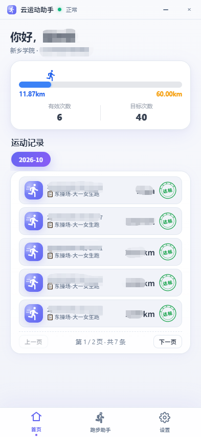
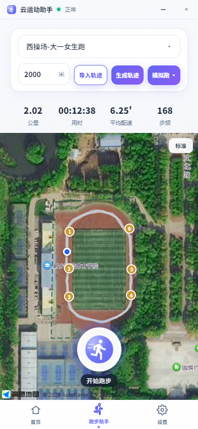
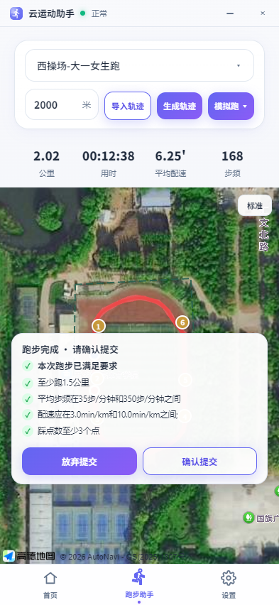
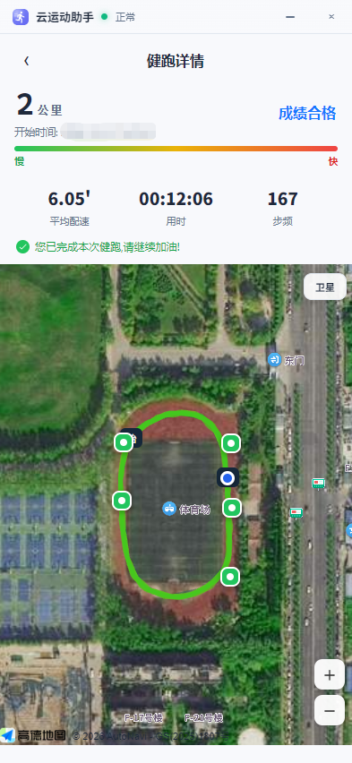
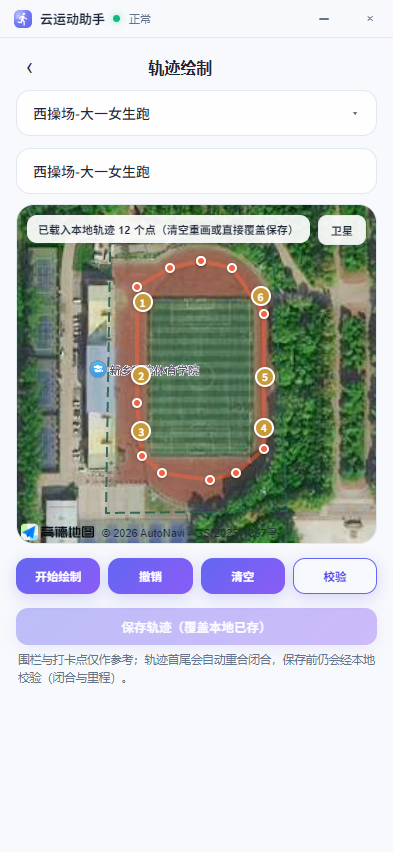
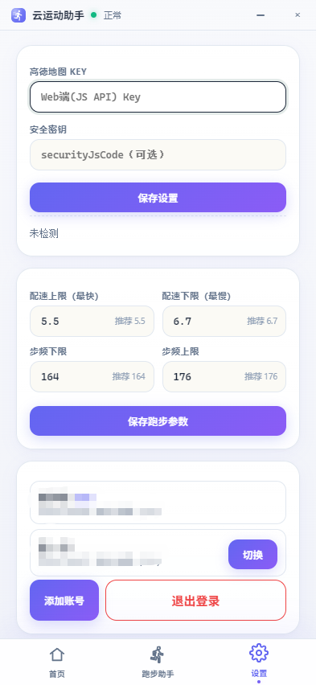

# 云运动助手（Tauri v2）

面向校园健跑平台的桌面端跑步助手：前端 Vite + React + TypeScript，后端 Tauri v2（Rust），
与云端接口通过国密 SM2 / SM4 加密封装交互，界面按手机竖屏（393×852）单窗口设计，自绘标题栏。

> 本项目仅供学习交流使用，请遵守所在学校的体育锻炼与考核规定，使用产生的后果由使用者自行承担。

## 应用截图

<table>
  <tr>
    <td align="center"><br /><sub>首页 · 里程进度与运动记录</sub></td>
    <td align="center"><br /><sub>跑步助手 · 跑区围栏与轨迹模拟</sub></td>
    <td align="center"><br /><sub>跑完校验 · 确认提交或放弃</sub></td>
  </tr>
  <tr>
    <td align="center"><br /><sub>健跑详情 · 按配速着色回放</sub></td>
    <td align="center"><br /><sub>轨迹绘制 · 地图取点与本地保存</sub></td>
    <td align="center"><br /><sub>设置 · 地图 Key、配速步频与多账号</sub></td>
  </tr>
</table>

## 功能特性

- **登录与多账号**：学校列表（支持拼音全拼 / 首字母搜索）+ 学号密码；本机可保存多个账号并随时切换，
  登录失效时自动用保存的密码重登，仍失败则回到登录页。
- **首页**：本跑区里程进度（已完成 / 目标，或有效次数 / 目标次数）、按月切换的运动记录列表（每页 5 条），
  点击任一记录进入详情。
- **跑步助手**：高德地图展示跑区围栏与打卡点；输入目标距离后「生成轨迹」，或从本地预设轨迹导入；
  「模拟跑」支持 1 / 10 / 30 / 60 倍速预览；「开始跑步」由后端后台任务分批上传点位，并实时回传
  里程、用时、配速、步频。
- **跑完校验**：提交前挂起成绩，展示平台返回的达标项（距离、配速、步频、踩点数等），
  由用户选择「确认提交」或「放弃提交」。
- **轨迹绘制**：在地图上逐点绘制路线，自动首尾闭合，可撤销 / 清空；校验闭合与里程后按跑区名保存到本地。
- **健跑详情**：里程、合格状态、开始时间、平均配速、用时、步频；轨迹按速度着色，标注起终点与打卡点，
  并做逐点动画回放。
- **设置**：高德 Key 与安全密钥（保存时联网检测）、配速与步频区间、本机账号管理、退出登录。

## 技术栈

| 层 | 选型 |
| --- | --- |
| 桌面壳 | Tauri v2（Rust，`windows` 无控制台 + 自绘标题栏） |
| 前端 | React 18 + TypeScript + Vite 5，单文件样式 `src/styles.css` |
| 后端 | Rust 2021，tokio + reqwest（rustls）+ serde |
| 加解密 | `sm2` / `sm4` / `cipher`：随机 SM4 密钥加密正文，SM2 加密该密钥作为 `cipherKey` |
| 地图 | 高德 Web 端 JS API（Key 由用户在设置页填写） |
| 中文搜索 | `pinyin-pro`（学校、跑区下拉的拼音检索） |

## 目录结构

```
cloud-sports-tauri/
├── index.html / vite.config.ts / tsconfig*.json   # 前端工程（Vite + React + TS）
├── package.json                                   # 脚本：dev / build / tauri dev / tauri build
├── docs/screenshots/                              # README 应用截图
├── public/                                        # 前端静态资源
├── src/                                           # 前端源码
│   ├── main.tsx / App.tsx                         # 入口与应用壳（标题栏 + 视图路由 + 底部 Tab）
│   ├── styles.css                                 # 全局样式（唯一样式文件）
│   ├── components/                                # 通用组件（下拉、确认弹窗、Logo、达标印章）
│   ├── pages/                                     # 页面：login / home / sim / draw / detail / set
│   ├── hooks/                                     # 后端存活探测、跑步进度事件、登录失效回调
│   ├── services/                                  # invoke 命令层，按 commands/ 域拆分
│   ├── store/                                     # 全局会话与配置（AppProvider）+ 记录落盘
│   ├── types/                                     # 与 Rust 结构体对齐的 TS 类型
│   └── utils/                                     # 高德加载与凭据检测、本机凭据、时间格式化
└── src-tauri/                                     # Rust 后端（Cargo 包 yunsport-assistant）
    ├── Cargo.toml / build.rs / tauri.conf.json
    ├── capabilities/default.json                  # Tauri v2 权限（拖拽 / 最小化 / 关闭）
    ├── icons/
    └── src/
        ├── main.rs                                # 极简入口 → yunsport::run()
        ├── lib.rs                                 # 命令注册、托管状态、启动任务
        ├── commands/                              # auth / run / record / track / face / setting / system
        ├── services/                              # 业务层：upstream 协议、跑步、轨迹、记录、人脸、持久化
        ├── models/                                # 配置模型（serde）
        ├── state/                                 # 学校缓存、后台任务、跑区刷脸状态
        ├── utils/                                 # crypto（国密）/ protocol（加密请求）/ 数据目录
        └── error.rs                               # 统一错误类型
```

## 快速开始

### 环境要求

- Node.js ≥ 18、pnpm
- Rust stable 工具链（`cargo`）
- Windows 10/11 需要 WebView2 运行时（Win11 通常已自带）
- 高德「Web 端（JS API）」Key + 安全密钥（可选，仅地图相关页面需要）

### 开发运行

```bash
pnpm install
pnpm tauri dev      # 启动 Vite + 编译并运行桌面端
```

> 只跑 `pnpm dev` 得到的是纯浏览器页面，`invoke` 等 Tauri API 不可用，功能会报错，请使用 `pnpm tauri dev`。

### 构建

```bash
pnpm tauri build
```

当前 `src-tauri/tauri.conf.json` 中 `bundle.active = false`，因此只产出可执行文件（`src-tauri/target/release/`），
不生成 exe / msi / dmg 安装包；需要安装包时把该项改为 `true` 再构建。

## 配置与本地数据

运行时数据统一落在**项目根目录下的 `data/`**（已被 `.gitignore` 忽略）：

| 路径 | 内容 |
| --- | --- |
| `data/config.json` | 应用配置：高德 Key / 安全密钥、配速区间、步频区间、默认学校等 |
| `data/cli_session.json` | 当前登录会话（token、学校、跑区信息） |
| `data/accounts.json` | 本机多账号，键为 `学号@学校编码` |
| `data/tracks/<学校编码>/<跑区名>.json` | 本地轨迹库（绘制结果、历史记录轨迹） |
| `data/faces/face_XXX.jpg` | 提交时轮询携带的人脸照片 |

前端另有几项 `localStorage`：`yunsport_acct` / `yunsport_remember`（记住账号）、
`yunsport_creds`（本机密码）、`yunsport_acc_invalid`（登录失效标记）、`yunsport_home_pref`（首页跑区偏好）、
`yunsport_records_saved`（历史记录已落盘标记）。

## 常见问题

- **地图空白或提示需要 Key**：到 <https://console.amap.com> 申请「Web 端（JS API）」类型的 Key，
  2021-12 之后申请的 Key 必须同时填写控制台生成的安全密钥，然后在「设置」页保存并检测。
- **提示 Key 类型不匹配**：Web 服务 Key 不能用于 JS API，请改用 Web 端（JS API）Key。
- **端口占用**：Vite 固定 5173（`strictPort`），被占用时先释放端口再启动。
- **登录失效**：token 过期会跳回登录页并给出提示；多账号场景可在设置页切换或重新登录。

## 许可

[MIT](LICENSE) © 2026 田鑫
